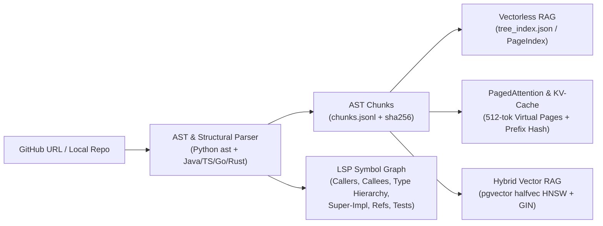

# Codebase AST, Call/Type Hierarchy & Vectorless/PagedAttention RAG Indexer

[](./LICENSE)
[](./skills/codebase-ast-rag-indexer/scripts/ast_rag_indexer.py)
[](#quick-start)

An open-source agentic skill & multi-harness plugin that clones any **GitHub repository URL** (or scans any local codebase) and constructs a complete **AST + Symbol Graph + Vectorless RAG + KV-Cache / PagedAttention** index using **zero external dependencies** (pure Python standard library).

---

## Architecture: From Raw Repository to KV-Cache & Vectorless RAG



## What It Extracts & Generates

| Output File | Description |
| :--- | :--- |
| **`index/chunks.jsonl`** | Hierarchical AST chunks (`class`, `interface`, `method`, `function`) with `parent_id`, `signature`, `docstring`, `token_count`, `sha256`, `kv_page_id`, `callers`, `callees`, `super_types`, `sub_types`, `super_implementation`, `type_definitions`, and linked `tests` |
| **`index/tree_index.json`** | Navigable **Vectorless RAG (PageIndex)** hierarchy (`Repo → Module → File → Symbol`) |
| **`index/call_graph.json`** | Bidirectional `incoming` (callers) & `outgoing` (callees) Call Hierarchy |
| **`index/type_hierarchy.json`** | `super_types` (`extends`/`implements`), `sub_types`, concrete `implementations`, method **`super_implementations`**, and **`type_definitions`** |
| **`index/references.json`** | Cross-file call & inheritance reference coordinates (`file:line`) |
| **`index/test_map.json`** | Production symbol → unit test traceability (`direct_call` & `name_match`) |
| **`index/kv_paged_blocks.json`** | Canonically sorted **PagedAttention virtual token pages** (`512` tok/page, deterministic `prefix_hash` for vLLM / Anthropic / Gemini KV-cache reuse) |
| **`index/pgvector_schema.sql`** | PostgreSQL **`pgvector 0.8+`** (`halfvec(1536)` HNSW + `tsvector` GIN) Hybrid RRF DDL |
| **`docs/00-INDEX.md` → `04-*.md`** | 5 cross-linked Markdown knowledge base files for human & agent navigation |

---

## Quick Start

```bash
# 1. Index any public GitHub repository (zero pip installs required!)
python skills/codebase-ast-rag-indexer/scripts/ast_rag_indexer.py \
  --repo "https://github.com/pgvector/pgvector-python" \
  --output "./output-rag" \
  --page-size 512

# 2. Vectorless RAG Tree Query
python skills/codebase-ast-rag-indexer/scripts/query_rag.py \
  --index "./output-rag/index" --query "HalfVector" --mode vectorless

# 3. Full LSP Symbol Card (Definition, Call Hierarchy, Type Hierarchy, Super-Impl, Tests)
python skills/codebase-ast-rag-indexer/scripts/query_rag.py \
  --index "./output-rag/index" --query "HalfVector" --mode symbol

# 4. KV-Cache Prefix-Stable & PagedAttention-Aligned Context Packet
python skills/codebase-ast-rag-indexer/scripts/query_rag.py \
  --index "./output-rag/index" --query "HalfVector" --mode kv-pack
```

---

## Bundled Open-Source Example (`examples/pgvector-python-rag-index/`)
- **[`00-INDEX.md`](./examples/pgvector-python-rag-index/docs/00-INDEX.md)** — Full telemetry & navigation for **`pgvector/pgvector-python`**
- **[`01-TREE-INDEX-VECTORLESS-RAG.md`](./examples/pgvector-python-rag-index/docs/01-TREE-INDEX-VECTORLESS-RAG.md)** — PageIndex tree for Vectorless RAG
- **[`02-CALL-AND-TYPE-HIERARCHY.md`](./examples/pgvector-python-rag-index/docs/02-CALL-AND-TYPE-HIERARCHY.md)** — Type hierarchy, overrides & call hubs
- **[`03-REFERENCES-AND-TESTS-MAP.md`](./examples/pgvector-python-rag-index/docs/03-REFERENCES-AND-TESTS-MAP.md)** — Production-to-test traceability
- **[`04-KV-CACHE-AND-PAGED-ATTENTION-PACKING.md`](./examples/pgvector-python-rag-index/docs/04-KV-CACHE-AND-PAGED-ATTENTION-PACKING.md)** — Virtual KV token page table
- **[`index/pgvector_schema.sql`](./examples/pgvector-python-rag-index/index/pgvector_schema.sql)** — PostgreSQL `pgvector` Hybrid RRF DDL

## Running Tests
```bash
python -m unittest discover -s tests -v
```
