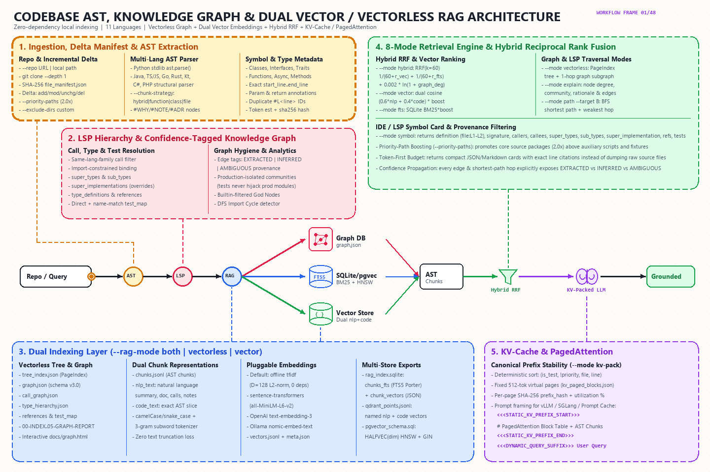

# Codebase AST, Knowledge Graph & Dual Vector/Vectorless RAG Indexer Skill (`v3.0`)

<p align="center">
  
</p>

<p align="center">
  <a href="https://github.com/NallaSanjayReddy/codebase-ast-rag-indexer-skill/actions/workflows/ci.yml"></a>
  <a href="https://github.com/NallaSanjayReddy/codebase-ast-rag-indexer-skill/actions/workflows/smoke-public-repos.yml"></a>
  <a href="./LICENSE"></a>
  
</p>

An open-source, zero-dependency agent skill (for **Antigravity**, **Claude Code**, **Codex**, and **Gemini CLI**) that clones any GitHub repository (or scans a local codebase) and builds **BOTH Vectorless RAG** (AST Tree + Confidence-Tagged Knowledge Graph) **AND Vector-Based RAG** (Dual NLP + Code Embeddings, SQLite FTS5 + Vector Store, Qdrant Points, PostgreSQL `pgvector` HNSW Schema, and Hybrid Reciprocal Rank Fusion) with **KV-Cache / PagedAttention** block packing.

---

## Visual Overview — End-to-End Architecture & Workflow



---

## 30-Second Setup Walkthrough (MP4)

> Watch the animated CLI & architecture setup walkthrough: **[`assets/setup_walkthrough.mp4`](./assets/setup_walkthrough.mp4)** (`1280×720`, 24fps H.264)

<video src="./assets/setup_walkthrough.mp4" controls width="100%"></video>

### Quick Start Commands

```bash
# 1. Clone the skill repo (zero external dependencies — pure Python 3 stdlib)
git clone https://github.com/NallaSanjayReddy/codebase-ast-rag-indexer-skill.git
cd codebase-ast-rag-indexer-skill

# 2. Index any GitHub repository or local codebase (BOTH Vectorless + Vector RAG)
python skills/codebase-ast-rag-indexer/scripts/ast_rag_indexer.py \
  --repo https://github.com/pgvector/pgvector-python \
  --output ./examples/pgvector-python-rag-index \
  --rag-mode both \
  --embedding-provider tfidf \
  --page-size 512 \
  --priority-paths pgvector \
  --incremental
```

**Output:**
```text
SUCCESS: Indexed 74 files -> 675 AST chunks, 675 dual vectors (tfidf d=128), 2491 graph edges (15 communities), 124 KV pages
```

Switch modes anytime: `--rag-mode vectorless` (zero embeddings), `--chunk-strategy hybrid|function|class|file`, or `--embedding-provider sentence-transformers|openai|ollama`.

---

## Dual RAG Capabilities (Vectorless + Vector + Hybrid RRF)

| Capability | Vectorless RAG (Zero Embeddings) | Vector-Based RAG (Dual Embeddings + Hybrid) |
| :--- | :--- | :--- |
| **Index Artifacts** | `tree_index.json`, `graph.json`, `call_graph.json`, `type_hierarchy.json`, `05-GRAPH-REPORT.md`, interactive `graph.html` | `vectors.jsonl`, `vector_meta.json`, `qdrant_points.jsonl`, `rag_index.sqlite` (`chunk_vectors` + `chunks_fts`), `pgvector_schema.sql` |
| **Retrieval Modes** | `--mode vectorless` (Tree + 1-hop Graph subgraph), `--mode explain`, `--mode path`, `--mode symbol` | `--mode vector` (Dual NLP + Code cosine similarity), `--mode fts` (SQLite FTS5 BM25), `--mode hybrid` (**RRF** fusing Vector + FTS5 + Graph) |
| **Embedding Providers** | Zero embeddings required (`--rag-mode vectorless`) | Pluggable: offline zero-dep `tfidf` (default, `D=128`), `sentence-transformers` (`all-MiniLM-L6-v2`), `openai`, `ollama` |
| **Graph & Symbol Hygiene** | Same-language-family + import-constrained call edges (`EXTRACTED` / `INFERRED` / `AMBIGUOUS`), production-isolated subsystem communities, import cycle detection, `# WHY:` / `# NOTE:` rationale nodes | Dual `nlp_text` + `code_text` embeddings, `--priority-paths` relevance boost, incremental SHA-256 `file_manifest.json` delta tracking |
| **LLM Inference Packing** | Canonical **KV-Cache prefix-stable** & **PagedAttention** 512-token virtual pages (`kv_paged_blocks.json`, `--mode kv-pack`) | Same KV-page coordinates stored in SQLite, Qdrant payload, and `pgvector` table for prefix-stable prompt packing |

---

## Included Multi-Language Public Examples

Three real open-source repositories are pre-indexed in [`examples/`](./examples/) across **Python** and **TypeScript**:

| Repository | Language | Files | AST Chunks & Dual Vectors | Graph Edges | KV Pages | Browse Outputs |
| :--- | :--- | :---: | :---: | :---: | :---: | :--- |
| **[`pgvector/pgvector-python`](https://github.com/pgvector/pgvector-python)** | Python | `74` | `675` | `2,491` (15 communities) | `124` | [00-INDEX.md](./examples/pgvector-python-rag-index/docs/00-INDEX.md) · [05-GRAPH-REPORT.md](./examples/pgvector-python-rag-index/docs/05-GRAPH-REPORT.md) · [graph.html](./examples/pgvector-python-rag-index/docs/graph.html) |
| **[`encode/httpx`](https://github.com/encode/httpx)** | Python | `60` | `1,150` | `6,247` (3 communities) | `327` | [00-INDEX.md](./examples/httpx-rag-index/docs/00-INDEX.md) · [05-GRAPH-REPORT.md](./examples/httpx-rag-index/docs/05-GRAPH-REPORT.md) · [graph.html](./examples/httpx-rag-index/docs/graph.html) |
| **[`sindresorhus/ky`](https://github.com/sindresorhus/ky)** | TypeScript | `98` | `658` | `173` (5 communities) | `49` | [00-INDEX.md](./examples/ky-rag-index/docs/00-INDEX.md) · [05-GRAPH-REPORT.md](./examples/ky-rag-index/docs/05-GRAPH-REPORT.md) · [graph.html](./examples/ky-rag-index/docs/graph.html) |

---

## Real Query Examples (8 Retrieval Modes)

### Example 1 — Hybrid Reciprocal Rank Fusion (`--mode hybrid`)
Fuses **Vector Cosine Rank + SQLite FTS5 BM25 Rank + Knowledge Graph Degree**:

```bash
python skills/codebase-ast-rag-indexer/scripts/query_rag.py \
  --index ./examples/pgvector-python-rag-index/index \
  --query "async psycopg register vector" \
  --mode hybrid --top-k 2
```

```json
{
  "mode": "hybrid_rrf",
  "query": "async psycopg register vector",
  "results": [
    {
      "chunk_id": "pgvector.psycopg.register.register_vector_async",
      "kind": "function",
      "community": "pgvector/psycopg",
      "kv_page_id": 22,
      "degree": 12,
      "vector_rank": 2,
      "fts_rank": 1,
      "rrf_score": 0.037652
    },
    {
      "chunk_id": "pgvector.psycopg.vector.register_vector_info",
      "kind": "function",
      "community": "pgvector/psycopg",
      "kv_page_id": 24,
      "degree": 5,
      "vector_rank": 4,
      "fts_rank": 5,
      "rrf_score": 0.034593
    }
  ]
}
```

### Example 2 — Pure Vector Search (`--mode vector`)
Blends dual `nlp_vector` (0.6 weight) and `code_vector` (0.4 weight) cosine similarity with `--priority-paths` boost:

```bash
python skills/codebase-ast-rag-indexer/scripts/query_rag.py \
  --index ./examples/pgvector-python-rag-index/index \
  --query "async psycopg register vector" \
  --mode vector --top-k 2
```

```json
{
  "mode": "vector",
  "query": "async psycopg register vector",
  "results": [
    {
      "chunk_id": "pgvector.psycopg2.vector.register_vector_info",
      "file": "pgvector/psycopg2/vector.py",
      "community": "pgvector/psycopg",
      "kv_page_id": 27,
      "nlp_cosine": 0.8358,
      "code_cosine": 0.4117,
      "score": 1.3323
    },
    {
      "chunk_id": "pgvector.psycopg.register.register_vector_async",
      "file": "pgvector/psycopg/register.py",
      "community": "pgvector/psycopg",
      "kv_page_id": 22,
      "nlp_cosine": 0.8745,
      "code_cosine": 0.2921,
      "score": 1.2831
    }
  ]
}
```

### Example 3 — Vectorless RAG: Tree + 1-Hop Knowledge Graph (`--mode vectorless`)

```bash
python skills/codebase-ast-rag-indexer/scripts/query_rag.py \
  --index ./examples/pgvector-python-rag-index/index \
  --query "HalfVector" \
  --mode vectorless --top-k 1
```

```markdown
# Vectorless Tree + 1-Hop Graph Subgraph for: 'HalfVector'

- **pgvector.django.halfvec.HalfVectorField** (`class` @ `pgvector/django/halfvec.py:8-47` | KV-Page `6` | Comm `pgvector/django` | deg=`2`)
  - Signature: `class HalfVectorField(Field):`
  - Graph 1-hop: `<-- tests.test_django.TestDjango.test_half_precision` [`calls` | `EXTRACTED`]
  - Graph 1-hop: `<-- tests.test_django.TestDjango.test_half_precision` [`tests` | `EXTRACTED`]
  - Tests (1): tests.test_django.TestDjango.test_half_precision
```

### Example 4 — Graph Explain & Shortest Path (`--mode explain`, `--mode path`)

```bash
python skills/codebase-ast-rag-indexer/scripts/query_rag.py \
  --index ./examples/pgvector-python-rag-index/index \
  --query "pgvector.vector.Vector" \
  --target "pgvector.halfvec.HalfVector" \
  --mode path
```

```text
Shortest path (2 hops) | Overall confidence (weakest hop): [EXTRACTED]
pgvector.vector.Vector <--[calls|EXTRACTED]<-- pgvector.asyncpg.register.register_vector -->[calls|EXTRACTED]--> pgvector.halfvec.HalfVector
```

### Example 5 — KV-Cache Prefix-Stable & PagedAttention Prompt Packet (`--mode kv-pack`)

```bash
python skills/codebase-ast-rag-indexer/scripts/query_rag.py \
  --index ./examples/pgvector-python-rag-index/index \
  --query "register_vector_async" \
  --mode kv-pack --top-k 1
```

```text
<<<STATIC_KV_PREFIX_START>>>
# PagedAttention Block Table: pages=[22] | total_chunks=1

## [KV-Page 22 | offset=0 | sha256=8f14e45fceea167a | comm=pgvector/psycopg] pgvector.psycopg.register.register_vector_async
# File: pgvector/psycopg/register.py:26-39 | SuperImpl: None | Tests: ['tests.test_psycopg.TestPsycopg.test_async']
async def register_vector_async(context):
    ...

<<<STATIC_KV_PREFIX_END>>>
<<<DYNAMIC_QUERY_SUFFIX>>>
User Query: register_vector_async
```

---

## CI, Validation & Release Workflows

- **[`.github/workflows/ci.yml`](./.github/workflows/ci.yml)** — Cross-OS matrix (`ubuntu`, `windows`, `macos` × Python `3.11`/`3.12`/`3.13`), manifest & `SKILL.md` contract checks (`scripts/validate_manifests.py`), unit tests, and 8-mode CLI smoke tests.
- **[`.github/workflows/smoke-public-repos.yml`](./.github/workflows/smoke-public-repos.yml)** — Weekly scheduled & manual public repository smoke tests (`pgvector-python`, `httpx`, `ky`).
- **[`.github/workflows/release.yml`](./.github/workflows/release.yml)** — Tag-triggered (`v*.*.*`) portable skill archive builder (`.tar.gz`, `.zip`, `SHA256SUMS.txt`).

```bash
python scripts/validate_manifests.py
python -m unittest discover -s tests -v
```

## Keywords & Topics
`rag` `vectorless-rag` `graph-rag` `hybrid-search` `ast` `code-indexing` `knowledge-graph` `call-hierarchy` `type-hierarchy` `kv-cache` `paged-attention` `pgvector` `qdrant` `sqlite-fts5` `bm25` `rrf` `agent-skills` `claude-code` `antigravity` `codex`

## License
MIT License — see [LICENSE](./LICENSE).
